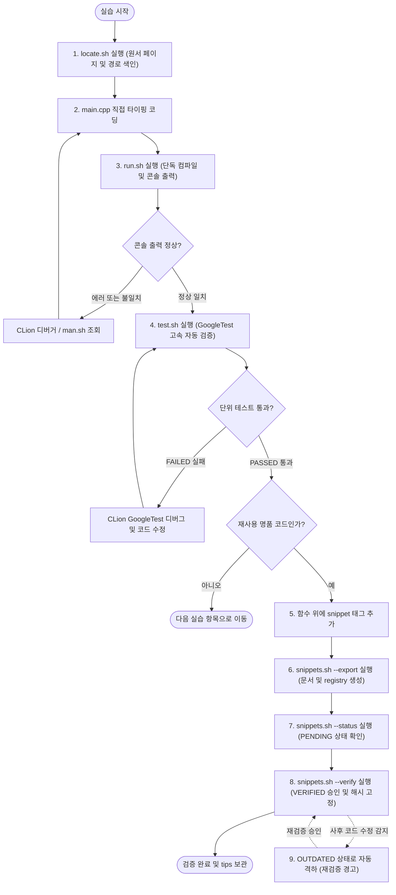

# 🚀 handcrafted-cpp 완벽 실습 가이드 (Operational Practice Guide)

> "교안을 펴고 ➔ 직접 손으로 빚어 타이핑하고(Handcrafted) ➔ 쉘 스크립트로 0.1초 만에 검증하고 ➔ 버그 발생 시 CLion 디버거로 추적하며 ➔ 명품 코드는 사람이 검증하여 `tips/`에 영구 보관한다."

본 문서는 `handcrafted-cpp` 저장소를 처음 접하거나 오랜만에 열어보았을 때, "어떻게 사용하지? 어떻게 실습해야 해? 어떤 쉘을 실행하고 어떻게 디버깅하지?" 라는 물음에 대해 가장 직관적인 실습 흐름과 도구 체계를 안내합니다.

---

## 🧭 1. 전체 실습 및 검증 루프 사이클 (Closed-Loop Cycle)

2,493개 모든 예제는 아래의 [탐색 ➔ 타이핑 ➔ 실행 ➔ 테스트 ➔ 디버깅 ➔ 스니펫 등록 ➔ 사람 검증] 루프 사이클로 정복합니다.



### 📋 루프 사이클 핵심 실행 명령 요약표

| 단계 | 실행 명령어 / 행동 | 판단 및 분기 (Branching) | 다음 액션 |
|:---:|:---|:---|:---|
| 1. 위치 색인 | `./scripts/locate.sh <키워드/경로>` | 교안/원서의 몇 장 몇 절 몇 페이지인지 색인 | 해당 PDF/원서 열람 및 `main.cpp` 오픈 |
| 2. 타이핑 | `main.cpp` 직접 코딩 | 스켈레톤 가이드 보며 손으로 직접 구현 | 3단계로 이동 |
| 3. 단독 실행 | `./scripts/run.sh <경로>` | • 에러 또는 출력 불일치 ➔ CLion 디버거 실행 (또는 `man.sh` 조회)<br/>• 콘솔 출력 정상 ➔ 4단계로 이동 | 0.1초 컴파일 & 콘솔 출력 확인 |
| 4. 단위 검증 | `./scripts/test.sh <경로>` | • `[ FAILED ]` 실패 ➔ CLion에서 GoogleTest 디버그<br/>• `[ PASSED ]` 통과 ➔ 5단계로 이동 | 0.1초 GoogleTest Fast-path 검증 |
| 5. 스니펫 태그 | 코드에 `[[snippet("설명")]]` 부여 | 재사용 가치가 있는 명품 함수인지 자가 판단 | 6단계로 이동 (아닐 경우 다음 문제로) |
| 6. 문서 내보내기 | `./scripts/snippets.sh --export` | 마크다운 문서 및 레지스트리 자동 갱신 | `tips/snippets.md` 생성 |
| 7. 상태 확인 | `./scripts/snippets.sh --status` | 🟡 `PENDING_REVIEW` (미검증) 목록 확인 | 체크리스트 자가 점검 |
| 8. 사람 검증 승인 | `./scripts/snippets.sh --verify` | 사람이 엣지케이스 검토 완료 후 승인 서명 | 🟢 `VERIFIED` 격상, 타임스탬프·해시 고정 |
| 9. 블로그 포스트 발행 | `./scripts/snippets.sh --export-blog` | GitHub Pages / Jekyll 호환 포스트 개별 생성 | `tips/posts/*.md` 자동 발행 (도서 출처·배지 포함) |
| 사후 변조 감지 | 원본 코드 수정 시 자동 감지 | SHA-256 해시 불일치 감지 ➔ 🔴 `OUTDATED` 격하 | 재검증 승인 시까지 경고 유지 |

---

## 🔰 2. 초심자를 위한 `run.sh` & `test.sh` 완벽 사용법

> 💡 골든 룰 (가장 흔한 실수 방지):  
> 터미널에서 `cd practice/...` 로 하위 폴더로 이동하지 마세요!  
> 항상 프로젝트 최상위 루트(`handcrafted-cpp/`)에서 명령어를 실행해야 합니다.  
> *(CLion 하단의 `Terminal` 탭을 누르면 자동으로 루트 경로에서 열립니다.)*

### 2.1 단일 코드 즉시 실행: `./scripts/run.sh`
내가 방금 `main.cpp`에 짠 코드가 잘 돌아가는지 눈으로 직접 콘솔 출력을 확인할 때 사용합니다.  
CMake 빌드를 기다리지 않고 `clang++ / g++`로 0.1초 만에 단독 컴파일 & 실행됩니다.

#### 기본 실행 및 자동완성 꿀팁:
```bash
# 기본 실행
./scripts/run.sh practice/stone-lecture/01_문법_STL/01_기본/03_define
```
- Tab 키 자동완성: 긴 폴더명을 다 칠 필요 없이, `./scripts/run.sh practice/stone-` 까지만 치고 `Tab` 키를 누르면 폴더명이 자동완성됩니다.
- 경로 단축: `practice/`를 깜빡하고 빼먹고 `./scripts/run.sh stone-lecture/...` 로 쳐도 스크립트가 알아서 찾아줍니다.
- 파일명 포함 가능: 폴더명 뒤에 `main.cpp`를 붙여서 실행해도 동일하게 동작합니다.

#### 콘솔 입력(`cin >> n`)이 필요한 문제 실행법:
- 방법 A: 키보드로 직접 값 타이핑하기
  ```bash
  ./scripts/run.sh practice/stone-lecture/01_문법_STL/02_기본자료형_입출력/01_cin_기본
  # 실행 후 터미널이 입력을 기다릴 때 숫자나 문자열을 치고 [Enter]
  10 20 [Enter]
  ```
- 방법 B: 파일로 입력값 한 번에 밀어넣기 (리다이렉션 `<`)
  ```bash
  # 종만북이나 백준 문제처럼 미리 준비된 .in 파일이 있는 경우
  ./scripts/run.sh practice/jongmanbook/06_brute_force/01_boggle < practice/jongmanbook/06_brute_force/01_boggle/boggle.in
  ```

#### 출력 화면 읽는 법:
- 🟢 성공 시: 내가 `std::cout`으로 찍은 결과만 화면에 즉시 출력됩니다.
- 🔴 문법 에러 시: `practice/.../main.cpp:16:5: error: ...` 형태로 줄 번호와 원인이 표시되므로 즉시 수정합니다.
- 🔴 Segmentation fault: 메모리 잘못 참조(배열 인덱스 초과 등) ➔ 아래의 CLion 디버거를 실행합니다.

---

### 2.2 자동 채점기: `./scripts/test.sh`
내가 짠 코드가 빈 문자열이나 경계값 등 모든 테스트 케이스를 완벽히 통과했는지 기계가 0.1초 만에 자동 채점해 주는 도구입니다.

#### 기본 실행:
```bash
./scripts/test.sh practice/stone-lecture/01_문법_STL/01_기본/03_define
```

#### 채점 결과 화면 읽는 법:
- 🟢 통과했을 때: `[  PASSED  ] 1 test.`
  ```text
  [==========] Running 1 test from 1 test suite.
  [ RUN      ] define.TODO
  [       OK ] define.TODO (0 ms)
  [----------] 1 test from define (0 ms total)
  [==========] 1 test from 1 test suite ran. (0 ms total)
  [  PASSED  ] 1 test.
  ```
  ➔ 초록색 `[  PASSED  ]`가 뜨면 "정답! 모든 예외 케이스 통과"입니다.
- 🔴 실패했을 때: `[  FAILED  ] 1 test.`
  ```text
  [ RUN      ] SplitTest.BasicComma
  practice/.../test.cpp:18: Failure
  Expected equality of these values:
    actual
      Which is: { "apple", "banana" }
    expected
      Which is: { "apple", "banana", "orange" }
  [  FAILED  ] SplitTest.BasicComma (0 ms)
  ```
  ➔ `actual`(내 코드가 반환한 값)과 `expected`(요구되는 진짜 정답)를 대조하여, 누락된 로직을 보정한 뒤 다시 `./scripts/test.sh`를 실행합니다.

---

## 🐞 3. CLion 환경에서의 디버거(Debugger) 사용법

터미널의 0.1초 고속 쉘(`run.sh`, `test.sh`)로 빠르게 사이클을 돌리다가, 원인 모를 세그멘테이션 폴트, 무한 루프, GoogleTest 실패(`[ FAILED ]`)를 만났을 때는 CLion의 GUI 디버거(LLDB)를 활용합니다.

```text
[평상시] 0.1초 초고속 터미널 루프 (run.sh ➔ test.sh)
    ▼ (버그 발생 / 맞왜틀!)
[디버깅] CLion 중단점(Cmd+F8) ➔ 디버그 실행(^D) ➔ 변수 감시 및 메모리 추적
    ▼ (원인 해결 완료)
[재검증] test.sh 통과 확인 ➔ snippets.sh 사람 검증 승인
```

### 3.1 `main.cpp` 로직 디버깅
1. 타깃 선택: CLion 우측 상단 타깃 드롭다운에서 현재 실습 중인 타깃 선택  
   *(예: `stone_lec01_03_12` ➔ `practice/stone-lecture/01_문법_STL/03_타입.../12_string_split` 타깃)*
2. 중단점(Breakpoint) 설정: 의심되는 코드 라인 좌측 여백 클릭 또는 `Cmd + F8` (`Ctrl + F8`)
3. 디버그 실행: 상단 벌레 모양 아이콘 클릭 또는 `Ctrl + D` (`Shift + F9`)
4. 단계별 추적:
   - `F8` (Step Over): 한 줄씩 실행
   - `F7` (Step Into): 함수 내부로 진입
   - `Opt + F8` (Evaluate Expression): 특정 수식이나 STL 컨테이너 내부 즉시 계산
   - 하단 Variables 창에서 포인터 주소, `vector` 크기, `string` 내용 실시간 확인

### 3.2 GoogleTest(`test.cpp`) 1클릭 GUI 디버깅
1. CLion 에디터에서 `test.cpp`를 열면, 각 `TEST(...)` 매크로 좌측에 초록색 재생/디버그 아이콘이 표시됩니다.
2. 디버그 아이콘을 클릭 ➔ "Debug '...'" 선택
3. 테스트가 실패한 단언문(`EXPECT_EQ`) 직전에 중단점을 걸어, 기대값(`expected`)과 실제 함수가 반환한 값(`actual`)을 GUI 메모리 창에서 바로 대조할 수 있습니다.

### 3.3 CLion 인덱싱 부하 경량화 팁
프로젝트에 2,400개 이상의 실행 타깃이 있으므로, 특정 도서/트랙에만 집중하고 싶을 때는 CLion CMake 설정에서 옵션을 지정합니다:
- 경로: `Settings` ➔ `Build, Execution, Deployment` ➔ `CMake` ➔ `CMake options`
- 설정값 예시:
  - `-DACTIVE_BOOK=08_prof_cpp` (Professional C++ 트랙만 활성화)
  - `-DACTIVE_BOOK=01_c_300` (C언어 300제만 활성화)
  - `-DACTIVE_BOOK=ALL` (기본값: 전체 활성화)

---

## 🏷️ 4. 스니펫 등록 및 사람 검증 감사 장치 (Human Verification)

실습 중 언제든 다시 꺼내 쓸 만한 명품 함수를 작성했다면:

1. 태그 달기: `main.cpp` 함수 위에 `[[snippet("설명")]]` 주석 추가
2. 문서 내보내기:
   ```bash
   ./scripts/snippets.sh --export
   ```
   ➔ [tips/snippets.md](file:///Users/flynn_macpro/githubs/stoneCpp/tips/snippets.md) 및 [tips/snippets_registry.json](file:///Users/flynn_macpro/githubs/stoneCpp/tips/snippets_registry.json)에 자동 수집
3. 상태 조회:
   ```bash
   ./scripts/snippets.sh --status
   ```
   ➔ 🟢 `VERIFIED` (검증완료), 🟡 `PENDING_REVIEW` (미검증), 🔴 `OUTDATED` (코드 수정됨)
4. 사람 검증 승인:
   ```bash
   ./scripts/snippets.sh --verify "split()" --reviewer "내이름" --notes "빈 문자열, 연속 구분자 단위테스트 통과 검증"
   ```
   ➔ 검증 일시(타임스탬프), 검증자, 코드 SHA-256 해시 영구 고정!
5. 사후 코드 변조 방지: 원본 코드가 1바이트라도 변경되면 SHA-256 해시 불일치로 자동 🔴 `OUTDATED`로 격하되어 재검증을 유도합니다.
6. 기술 블로그 / GitHub Pages 포스트 자동 발행:
   ```bash
   ./scripts/snippets.sh --export-blog
   ```
   ➔ [tips/posts/](file:///Users/flynn_macpro/githubs/stoneCpp/tips/posts/) 에 도서명·장·절·페이지 원전 인용과 사람 검증 배지가 포함된 마크다운 포스트(`YYYY-MM-DD-<slug>.md`)가 100% 자동 생성됩니다! (Jekyll / MkDocs Material 즉시 호환)

---

### 📂 관련 파일 바로가기 링크
- 📄 전체 실습 가이드 문서: [PRACTICE_GUIDE.md](file:///Users/flynn_macpro/githubs/stoneCpp/PRACTICE_GUIDE.md)
- 📄 AI 에이전트 메모리 규칙: [AGENTS.md](file:///Users/flynn_macpro/githubs/stoneCpp/AGENTS.md)
- 📄 프로젝트 구조 및 설계 의도: [PROJECT_STRUCTURE.md](file:///Users/flynn_macpro/githubs/stoneCpp/PROJECT_STRUCTURE.md)
- 📄 메인 리드미: [README.md](file:///Users/flynn_macpro/githubs/stoneCpp/README.md)
- 📄 검증된 스니펫 도서관: [tips/snippets.md](file:///Users/flynn_macpro/githubs/stoneCpp/tips/snippets.md)
- 📄 블로그 포스트 저장소: [tips/posts/](file:///Users/flynn_macpro/githubs/stoneCpp/tips/posts/)
- 📄 사람 검증 데이터베이스: [tips/snippets_registry.json](file:///Users/flynn_macpro/githubs/stoneCpp/tips/snippets_registry.json)
- ⚙️ 단독 실행 스크립트: [scripts/run.sh](file:///Users/flynn_macpro/githubs/stoneCpp/scripts/run.sh)
- ⚙️ 단위 검증 스크립트: [scripts/test.sh](file:///Users/flynn_macpro/githubs/stoneCpp/scripts/test.sh)
- ⚙️ CMake 루트 설정: [CMakeLists.txt](file:///Users/flynn_macpro/githubs/stoneCpp/CMakeLists.txt)
