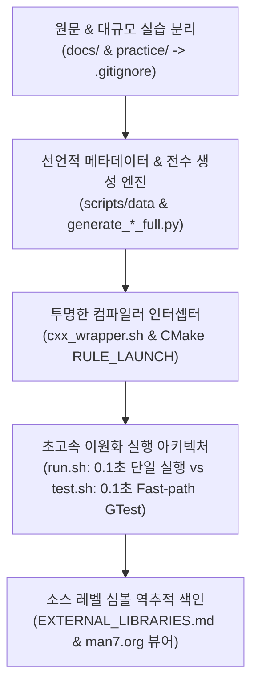
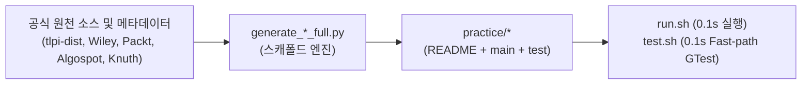

# 🏗️ handcrafted-cpp 아키텍처 및 디렉터리 트리 상세 설계서 (Project Structure & Intent)

> 이 문서는 본 프로젝트(`handcrafted-cpp`)의 전체 디렉터리 구조와 각 컴포넌트의 엔지니어링 설계 의도를 정의한 표준 아키텍처 명세서입니다.  
> 향후 다른 언어(Rust, Go, Python 등)나 새로운 학습 트랙, 대규모 실습 프로젝트를 설계할 때도 본 아키텍처 패턴을 그대로 청사진(Blueprint)으로 활용할 수 있도록 작성되었습니다.

---

## 1. 핵심 설계 철학 (Architectural Principles)

본 프로젝트는 "2,400개 이상의 방대한 실습 코드를 다루면서도 저장소를 깃허브 친화적으로 초경량 유지하고, 빌드 속도와 테스트 편의성을 극대화한다"는 목표 아래 5가지 원칙으로 설계되었습니다.



1. 선언적 메타데이터와 전수 생성 엔진 분리 (Scaffold Engine Pattern):
   * 2,493개에 달하는 `main.cpp`, `test.cpp`, `README.md` 코드를 수작업으로 관리하지 않고, 공식 배포 소스/예제/문제 명세와 메타데이터를 기반으로 생성 엔진(`generate_*_full.py`)이 일괄 생성/검증합니다.
2. 저작권 보호 및 레포지토리 경량화:
   * PDF 원문(`docs/`)과 실제 생성된 실습 디렉터리(`practice/`)는 `.gitignore`로 제외하여, Git 레포지토리의 용량을 수 MB 단위로 유지하면서 저작권 침해를 원천 차단합니다. 누구나 레포를 클론 후 생성 스크립트로 전체 실습환경을 수 초 만에 재구성할 수 있습니다.
3. 투명 컴파일러 인터셉터 (Transparent Compiler Interceptor):
   * 학습자가 `@snippet("설명")` 또는 `[[snippet]]` 같은 메타 속성을 코드에 자유롭게 작성하더라도, 표준 C++ 컴파일러가 에러를 내지 않도록 `cxx_wrapper.sh`가 컴파일 파이프라인에서 투명하게 전처리합니다.
4. 초고속 Fast-path 실행 및 테스트 파이프라인:
   * 초고속 단일 실행 (`run.sh`): CMake 전체 빌드 없이 0.1초 만에 `g++ / clang++ -std=c++20/c++23` 직접 빌드로 결과 확인.
   * 초고속 GoogleTest 검증 (`test.sh`): 사전 빌드된 `libgtest_main.a` 정적 라이브러리를 직접 링크하는 Fast-path를 내장하여 수천 개 타깃 환경에서도 0.1~0.2초 만에 단일 테스트를 즉시 검증.
5. 소스 레벨 심볼 역추적 색인 & 오프라인 Linux 매뉴얼:
   * C++17 표준 헤더 110종, libc++, POSIX 시스템 헤더의 심볼(함수, 클래스) 3,686개를 실제 로컬 SDK 파일 줄 번호와 매핑한 `EXTERNAL_LIBRARIES.md`와 Linux man7 공식 매뉴얼 2,666개를 터미널에서 즉시 조회할 수 있는 `./scripts/man.sh`를 제공합니다.

---

## 2. 전체 디렉터리 트리 (Visual Directory Tree)

```text
handcrafted-cpp/
├── CMakeLists.txt                 # 프로젝트 루트 CMake 빌드 명세서 (타깃 자동 로드)
├── README.md                      # 전체 프로젝트 개요 및 실습 명령어 퀵스타트
├── PROJECT_STRUCTURE.md           # [본 문서] 프로젝트 구조 및 트리별 설계 의도 명세서
├── EXTERNAL_LIBRARIES.md          # C++17 / libc++ / POSIX 헤더 3,686개 심볼 소스라인 색인
├── .gitignore                     # Git 형상관리 제외 규칙 (/practice/, /docs/ 등)
│
├── scripts/                       # 🛠️ 자동화 스크립트, 생성기 엔진, 런타임 툴체인
│   ├── cxx_wrapper.sh             # 컴파일러 호출을 가로채 @snippet 등을 투명 처리하는 래퍼
│   ├── run.sh                     # 단일 main.cpp 초고속 컴파일 및 실행기 (C++17/20/23 지원)
│   ├── test.sh                    # 특정 항목의 GoogleTest 타깃 0.1초 Fast-path 실행기
│   ├── linux_run.sh               # 리눅스 시스템 프로그래밍 전용 래퍼 실행기
│   ├── man.sh                     # man7.org Linux 공식 매뉴얼(2,666개) 오프라인 뷰어
│   ├── help.sh                    # 전체 CLI 사용법 대화형 안내 스크립트
│   ├── snippets.sh / snippets.py  # 실습 코드 내 스니펫 추출 및 인덱싱 도구
│   ├── locate.sh / locate.py      # 실습 파일 위치 네비게이터 (어느 책, 몇 장, 몇 절, 몇 문단/페이지 색인)
│   ├── sync_all.sh                # 목차/트리구조 변경 시 프론트매터 및 트리 일괄 동기화 마스터 파이프라인
│   ├── apply_file_frontmatter.py  # 모든 말단 노드 파일에 @file/@path 주석 프론트매터 자동 주입 도구
│   ├── ocr_pdf.swift              # macOS Vision 프레임워크 기반 PDF 고속 OCR 추출기
│   ├── generate_linux_tlpi_full.py # TLPI 68개 전 챕터 (506개: 312예제+194연습문제) 전수 생성기
│   ├── generate_linux_cli_full.py  # Linux CLI & Shell Automation 24개 전 챕터 (46개) 전수 생성기
│   ├── generate_content_07_full.py # Extreme C 23개 전 챕터 (114개) 전수 생성기
│   ├── generate_content_08_full.py # Professional C++ 35개 전 챕터 (499개: 345예제+154연습문제) 전수 생성기
│   ├── generate_jongmanbook_full.py # 종만북 알고리즘 32개 전 챕터 (94개) 전수 생성기
│   ├── generate_knuth.py          # TAOCP Vol 4A 조합 알고리즘 (13개) 전수 생성기
│   ├── generate_content_01.py ~ 06.py # C/C++ 1~6권 스캐폴드 생성기
│   ├── generate_practice-01.py, 02.py # 큰돌 알고리즘 교안 스캐폴드 생성기
│   ├── content01_data/ ~ content08_data/ # C/C++ 8대 명저별 챕터 메타데이터
│   └── linux_data/                 # Linux 트랙 챕터 메타데이터
│
├── practice/                      # 🎯 [생성물/gitignore] 실제 학습자가 직접 타이핑하고 실습하는 원본 공간 (총 2,493개 항목)
│   ├── stone-lecture/             # 🎓 큰돌 알고리즘 강의 트랙 (총 409개 항목)
│   │   ├── 01_문법_STL/           # 코딩테스트 C++ 기초 문법 및 STL 필수 (14개 섹션, 182개)
│   │   ├── 02_알고리즘_개념/       # 코딩테스트 핵심 알고리즘/자료구조 심화 (22개 섹션, 67개)
│   │   └── 03_실전_문제풀이/       # 8주차 실전 문제풀이 및 백트래킹/DP (8개 섹션, 160개)
│   │
│   ├── c-and-cpp/                 # 📚 C/C++ 8대 명저 전수 실습 트랙 (총 1,425개 항목)
│   │   ├── 01_c_300/              # C언어 300제 (6개 챕터, 315개 항목)
│   │   ├── 02_c_100/              # 실무자를 위한 C언어 100제 (5개 챕터, 100개 항목)
│   │   ├── 03_tour_of_cpp/        # A Tour of C++ 3rd Ed (16개 챕터, 113개 항목)
│   │   ├── 04_cpp_stl/            # C++ STL 프로그래밍 (10개 챕터, 100개 항목)
│   │   ├── 05_high_perf_cpp/      # 고성능을 위한 C++ (11개 챕터, 80개 항목)
│   │   ├── 06_algo_generic/       # 알고리즘 산책: 수학에서 제네릭까지 (15개 챕터, 104개 항목)
│   │   ├── 07_extreme_c/          # 전문가를 위한 C (Extreme C) (23개 전 챕터, 114개 항목)
│   │   └── 08_prof_cpp/           # 전문가를 위한 C++ 6th Ed (35개 전 챕터, 499개 항목)
│   │
│   ├── linux/                     # 🐧 리눅스 시스템 프로그래밍 & CLI 트랙 (총 552개 항목)
│   │   ├── 01_tlpi_system_programming # TLPI 리눅스 프로그래밍 인터페이스 (68개 전 챕터, 506개 항목)
│   │   └── 02_cli_and_shell_automation # 리눅스 CLI 및 셸 스크립팅 자동화 (24개 전 챕터, 46개 항목)
│   │
│   ├── knuth/                     # 👑 도널드 크누스: The Art of Computer Programming Vol 4A (총 13개 항목)
│   │   ├── 01_zeros_and_ones      # 비트 트릭(Broadword 컴퓨팅), 불리언 대수, ROBDD (4개 항목)
│   │   └── 02_generating_all_possibilities # 순열(Alg L/P/Heap), 조합(Alg T/L), 분할, 트리 전수 생성 (9개 항목)
│   │
│   └── jongmanbook/               # 🏆 프로그래밍 대회에서 배우는 알고리즘 문제 해결 전략 (종만북) (총 94개 항목)
│       └── 01_problem_solving... ~ 32_network_flow # 32개 전 챕터 (알고스팟 공식 문제 및 .in/.out 테스트베드)
│
├── contents/                      # 📖 [참조자료/gitignore] 공식 문서 및 학습용 원문 자료 (practice와 1:1 디렉터리 동기화)
│   ├── c-and-cpp/                 # C/C++ 8대 명저 챕터별 원문 PDF (01_c_300 ~ 08_prof_cpp)
│   ├── jongmanbook/               # 종만북 1·2권 원문 PDF (총 1,084페이지)
│   ├── knuth/                     # TAOCP Volume 4A: Combinatorial Algorithms 원문 PDF (963MB)
│   ├── linux/                     # 리눅스 시스템 공식 문서 및 원서
│   │   ├── 01_tlpi_system_programming/ # TLPI 1·2권 PDF, man7 매뉴얼(2,666개), tlpi-dist(391개), 명세서
│   │   └── 02_cli_and_shell_automation/ # Adventures..., Efficient Linux... 원문 PDF
│   ├── stone-lecture/             # 큰돌 알고리즘 강의 교안 PDF (01_문법_STL, 02_알고리즘_개념, 03_실전_문제풀이)
│   ├── googletest/                # GoogleTest & GoogleMock 공식 마크다운 가이드 풀세트
│   └── cpp-reference/             # 오프라인 C++ 표준 레퍼런스
│
└── tips/                          # 💡 [버전관리] 단위테스트 실무 팁 및 스니펫
    ├── snippets.md                # 자주 쓰는 C++ 핵심 스니펫 모음 및 검증 대시보드
    ├── snippets_registry.json     # 사람 검증 일시·서명·해시 영구 보관 레지스트리
    ├── posts/                     # [GitHub Pages] 개별 기술 블로그 포스트 마크다운 저장소
    └── string_split_해설.md        # 코딩테스트 필수 문자열 split 상세 해설
```

---

## 3. 트리 노드별 상세 설계 의도 (Node-by-Node Architectural Intent)

### 3.1 루트 디렉터리 (Root Configuration)

| 파일 / 폴더 | 설계 의도 및 역할 | 다른 프로젝트 도입 시 참고 가이드 |
| :--- | :--- | :--- |
| `CMakeLists.txt` | • C++17/20/23 호환 빌드 및 GoogleTest `FetchContent` 자동화<br/>• `ACTIVE_BOOK` 옵션을 두어 수천 개 타깃 중 원하는 도서만 선택 빌드 가능하게 하여 IDE 인덱싱 부하 방지<br/>• `RULE_LAUNCH_COMPILE`로 `cxx_wrapper.sh`를 전역 바인딩 | 타깃이 수백 개 이상인 대규모 프로젝트에서는 전체를 매번 add_subdirectory 하지 말고 옵션 플래그(`ACTIVE_*`)로 특정 모듈만 켜고 끌 수 있게 설계할 것. |
| `PROJECT_STRUCTURE.md` | • 본 문서. 디렉터리의 물리적 구조뿐 아니라 "왜 이렇게 설계했는지" 의도와 규칙을 명시 | 팀원이나 AI 에이전트가 폴더의 용도를 오해하여 엉뚱한 위치에 파일을 생성하지 않도록 아키텍처 가드레일 역할을 함. |
| `EXTERNAL_LIBRARIES.md` | • C++17 표준 헤더(110종), libc++, Apple SDK의 심볼(3,686개)과 파일/라인 번호 매핑<br/>• IDE를 거치지 않고도 AI 에이전트나 개발자가 표준 라이브러리 내부 구현 소스로 바로 점프할 수 있는 하이퍼링크 제공 | 외부 SDK나 대형 라이브러리(Boost, ROS, Qt 등)를 쓸 때 헤더/소스 매핑 색인을 자동 생성해 두면 AI 분석 능력이 극대화됨. |
| `.gitignore` | • `docs/`(원문 PDF), `practice/`(대량 생성 코드), `cmake-build-*/`(빌드 산출물), `__pycache__/` 차단<br/>• 순수 설정 및 생성 엔진 코드만 깃으로 추적 | 산출물(Artifacts)과 엔진(Generator)을 엄격히 분리하여 레포지토리 오염 방지. |

---

### 3.2 `scripts/` (자동화 도구 및 툴체인 엔진)

이 폴더는 저장소의 "심장" 역할을 하며, 모든 반복 작업을 코드로 추상화합니다.



* `cxx_wrapper.sh`:
  * 의도: 코드에 삽입된 `@snippet("이름")`이나 주석 처리된 커스텀 메타데이터를 정규식으로 안전하게 치환하거나 `-Wno-attributes` 플래그를 자동 추가하여 컴파일 실패를 방지하는 인터셉터.
* `run.sh` vs `test.sh`:
  * 의도: 실행 목적에 따른 파이프라인 분리.
    * `run.sh`: CMake 구성 없이 `g++ / clang++` 단일/다중 파일 빌드로 0.1초 내 터미널 실행 결과를 확인. C++20/C++23(`<print>`, `std::println`) 자동 감지.
    * `test.sh`: 사전 빌드된 `libgtest_main.a`를 직접 링크하는 Fast-path를 통해 0.1초 만에 GoogleTest 바이너리를 빌드/실행.
* `man.sh`:
  * 의도: macOS 터미널 환경에서도 Linux man-pages 6.20 2,666개 문서를 `/usr/bin/mandoc`으로 즉시 열람할 수 있는 오프라인 Linux 매뉴얼 뷰어.
* **`generate_*_full.py` 전수 생성기 엔진**:
  * 의도: 스캐폴드 멱등성(Idempotency)과 전수 커버리지(Zero Abbreviation) 보장.
  * 책의 모든 챕터, 본문 공식 예제, 공식 연습문제를 빠짐없이 생성하고 공식 테스트 케이스를 자동 바인딩.

---

### 3.3 `practice/` (실습 및 학습 런타임 공간)

사용자가 매일 코드를 직접 따라치고(Active Learning Hand-Typing) 테스트를 돌려보는 실습 장소입니다. 총 2,535개의 세분화된 디렉터리가 표준화된 자기완비형 구조로 관리됩니다.

* 하위 디렉터리 구성 (17개 트랙 완역):
  * `stone-lecture/`: 큰돌 알고리즘 강의 트랙 (`01_문법_STL`, `02_알고리즘_개념`, `03_실전_문제풀이` — 409개)
  * `c-and-cpp/`: C/C++ 8대 명저 완역 트랙 (`01_c_300` ~ `08_prof_cpp` — 1,425개)
  * `linux/`: 리눅스 시스템 프로그래밍, CLI, BPF, ARM 커널 트랙 (`01_tlpi_system_programming`, `02_cli_and_shell_automation`, `03_bpf_performance_tools`, `04_arm_kernel` — 594개)
  * `jongmanbook/`: 구종만 알고리즘 문제 해결 전략 트랙 (32개 전 챕터 — 94개)
  * `knuth/`: 도널드 크누스 TAOCP Volume 4A 조합 알고리즘 트랙 (`01_zeros_and_ones`, `02_generating_all_possibilities` — 13개)

* 표준 실습 항목 폴더 구성 (항목당 3개 파일 표준):
  ```text
  01_01_item_name/
  ├── README.md       # 개념 설명, 원서 출처, 알고리즘 분석, 컴파일/실행 가이드
  ├── main.cpp        # 학습자가 타이핑하고 실행할 수 있는 메인 소스 코드
  ├── test.cpp        # GoogleTest 기반 자동 채점/검증 테스트 코드
  ├── (input.in)      # [종만북/알고리즘] 공식 입력 테스트케이스
  └── (output.out)    # [종만북/알고리즘] 공식 예상 출력 데이터
  ```

---

### 3.4 `contents/` (참조 레퍼런스 및 라이브러리 공식 문서 — practice와 1:1 디렉터리 동기화)

* `contents/c-and-cpp/` (01_c_300 ~ 08_prof_cpp): C/C++ 8대 명저 원문 PDF 8권
* `contents/jongmanbook/`: 종만북 1·2권 원문 PDF (총 1,084페이지)
* `contents/knuth/`: TAOCP Volume 4A: Combinatorial Algorithms 원문 PDF (963MB)
* `contents/linux/`:
  * `01_tlpi_system_programming/`: TLPI 1·2권 원문 PDF, man7 매뉴얼(2,666개), tlpi-dist(391개), 명세서
  * `02_cli_and_shell_automation/`: Adventures with the Linux Command Line, Efficient Linux at the Command Line 원문 PDF
  * `03_bpf_performance_tools/`: BPF 성능 분석 도구 (BPF Performance Tools, Brendan Gregg 저) 원문 PDF (973p)
  * `04_arm_kernel/`: 코드로 알아보는 ARM 리눅스 커널 (강진우 저) 원문 PDF (938p)
* `contents/stone-lecture/`: 큰돌 C++ 알고리즘 강의 교안 PDF (01_문법_STL, 02_알고리즘_개념, 03_실전_문제풀이)
* `contents/googletest/`: GoogleTest & GoogleMock 공식 마크다운 가이드 풀세트
* `contents/cpp-reference/`: 오프라인 C++ 표준 레퍼런스

---

### 3.5 `tips/` (실전 가이드 및 스니펫 감사 레지스트리)

* `snippets.md`:
  * 의도: 프로젝트 내 `[[snippet]]` 태그가 달린 핵심 함수 및 클래스 모음. 상단에 사람 검증 현황 대시보드(🟢 `VERIFIED`, 🟡 `PENDING_REVIEW`, 🔴 `OUTDATED`), 원서 출처 인용 및 체크리스트 자동 갱신.
* `snippets_registry.json`:
  * 의도: 각 스니펫의 원본 코드 SHA-256 해시, 검증 일시, 검증자, 메모를 영구 보관하는 기계 판독형 검증 레지스트리.
* `posts/`:
  * 의도: `./scripts/snippets.sh --export-blog` 실행 시 생성되는 GitHub Pages / Jekyll 호환 개별 포스트(`YYYY-MM-DD-<slug>.md`). 도서명, 장, 절, 원서 쪽수 인용과 사람 검증 배지가 기본 탑재됨.
* `string_split_해설.md`:
  * 의도: 코딩테스트 및 실전 C++에서 자주 쓰이는 문자열 분할 구현 상세 해설.

---

## 4. 다른 프로젝트에 이 아키텍처를 이식하는 방법 (Blueprint Guide)

새로운 도서나 다른 프로그래밍 언어(예: Rust, Go, Python)로 유사한 대규모 학습/실습 시스템을 구축할 때 다음 4단계를 따릅니다:

```text
[Step 1] 공식 원천 소스 및 데이터 분석 (docs/ 또는 scripts/*_data/)
  └── 공식 배포 코드, 챕터 인덱스, 테스트케이스를 파이썬 딕셔너리/구조체로 모델링

[Step 2] 전수 스캐폴딩 생성기 작성 (scripts/generate_*_full.py)
  └── 템플릿(README.md, main.*, test.*)에 데이터를 주입하여 디렉터리 일괄 생성

[Step 3] 초고속 실행/테스트 러너 연동 (scripts/run.sh & test.sh)
  └── CMake 재구성 없이 단일 타깃을 0.1초 만에 컴파일하고 사전 빌드된 테스트 러너 링크

[Step 4] 빌드 시스템 연동 (CMake / Cargo / Makefile)
  └── 대량 타깃 처리를 위한 함수(Macro) 정의 및 선택 빌드 옵션(ACTIVE_*) 추가
```

이 구조를 준수하면 수천 개의 예제와 연습문제가 누적되더라도 프로젝트가 지저분해지지 않고, 언제나 깔끔한 형상 관리와 초고속 피드백 루프를 유지할 수 있습니다.
